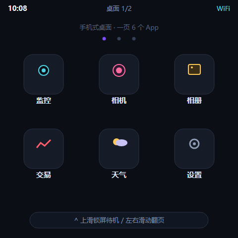

# ESP32-P4C5 开发项目

基于 **OSPTEK ESP32-P4C5 核心板**（ESP32-P4 + ESP32-C5 双芯片）的一组嵌入式工程与硬件资料。主工程是一台带 480×480 触摸屏的"手机式"设备，集成监控、相机、相册、音乐、股票行情、天气、设置等应用；另附早期整机 demo 与远程音频监控工程。仓库包含从零复刻所需的原理图、数据手册、固件、源码与构建说明。



> 界面示意图依据项目实现绘制，非真机截图。更多界面见 `assets/generated/`。

## 仓库结构

```
.
├── projects/                 三个 ESP-IDF 工程（源码 + 配置 + 依赖）
│   ├── esp32-p4c5-ipcam/     主工程：桌面系统 + RTSP 网络监控（当前 V2.38）
│   ├── esp32-p4c5-demo/      早期整机 demo：相机预览 + 音频回环
│   └── esp32-p4c5-audio-monitor/  远程音频监控：麦克风采集 → Wi-Fi 推流
├── hardware/                 硬件资料（原理图、数据手册、规格书 PDF）
├── firmware/                 ESP32-C5 ESP-Hosted 合并固件
├── docs/                     ARCHITECTURE / REPLICATION / 审计报告 / 构建补丁
└── assets/generated/         界面示意图（PNG + SVG 源文件 + 生成脚本）
```

## 硬件基线

| 部件 | 型号 |
|---|---|
| 核心板 | ESP32-P4 rev v3.2 + ESP32-C5HF4 rev v1.2（88Pin） |
| 主控 | P4 双核 RISC-V 400MHz，16MB Flash + 32MB PSRAM |
| 无线 | C5：Wi-Fi 6 双频 + BLE5，经 SDIO 4-bit 连接 P4 |
| 显示屏 | YDP395BT008-V1，3.95″ 480×480 MIPI-DSI，ST7123 触摸 |
| 摄像头 | SC2336 2MP MIPI-CSI |
| 音频 | ES8311 codec + NS4150B 功放 + 板载麦克风 |
| 存储 | TF 卡（SDMMC）+ Flash `storage` 分区 |

完整 GPIO 分配、P4↔C5 SDIO 引脚、启动配置见 [`docs/ARCHITECTURE.md`](docs/ARCHITECTURE.md) 与 [`docs/REPLICATION.md`](docs/REPLICATION.md)。

## 快速开始

1. **环境**：ESP-IDF v5.5.5，Python 3.11 虚拟环境。构建前设置 `ESP_IDF_VERSION=5.5`（major.minor），并从 bash 发起构建——详见 [`docs/REPLICATION.md`](docs/REPLICATION.md)。
2. **烧录 C5 固件**：拨码拨到 C5，将 `firmware/` 中的合并固件烧写到 `0x0`。
3. **构建 P4 工程**（以主工程为例）：
   ```bash
   cd projects/esp32-p4c5-ipcam
   bash build.sh              # 编译
   bash flash.sh <串口>       # 拨码拨到 P4 后烧录，如 bash flash.sh COM3
   ```
   另外两个工程的使用说明见其目录内 `README.md`。
4. **构建路径**：`build.sh` / `flash.sh` 内的 `BUILD_DIR`、`IDF_PATH` 等默认值按原开发环境设置。在自己的机器上请先按实际路径覆盖这些环境变量（详见 `docs/REPLICATION.md` §2）；也可直接改脚本顶部的默认值。
5. **复刻注意**：部分 ESP-IDF 工具脚本带有构建环境相关调整（见 `docs/patches/`），换机器构建前请按 `docs/REPLICATION.md` 处理。

## 文档

| 文档 | 内容 |
|---|---|
| `docs/ARCHITECTURE.md` | 硬件基线、分层架构、数据流、GPIO 总表、风险项 |
| `docs/REPLICATION.md` | 构建环境、关键配置、工具链补丁、故障排查 |
| `docs/DEVELOPMENT.md` | 版本里程碑、关键技术决策与根因分析 |
| `docs/patches/` | `ldgen.py` 等构建工具补丁说明与文件 |
| `docs/R-30-SDIO接收缓冲.md` | SDIO 接收缓冲与偶发重启的根因分析 |
| `docs/ESP32-P4C5_审计与稳定性报告_2026-11-19.md` | 首轮代码审计与稳定性分析 |
| `docs/ESP32-P4C5_复审报告_2026-11-21.md` | 复审结论：整改闭环状态、新增问题与待办 |

## 许可

硬件资料版权归原厂商（OSPTEK / 乐鑫）所有；`managed_components/` 中的第三方组件遵循各自许可证。
